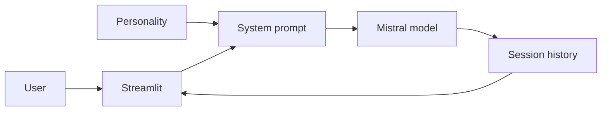

# AI Chatbot with Personality Modes

A Streamlit-powered chatbot with multiple personality modes using Mistral AI.

## Features

- 🤖 Three personality modes: Angry AI, Funny AI, Sarcastic AI
- 💬 Real-time chat interface
- 🔄 Chat history with clear function
- 🎨 Clean, modern UI

## Setup

### 1. Clone or download this project

### 2. Create a virtual environment
```bash
python -m venv .venv
```

### 3. Activate the virtual environment

**Windows:**
```bash
.venv\Scripts\activate
```

**Mac/Linux:**
```bash
source .venv/bin/activate
```

### 4. Install dependencies
```bash
pip install -r requirements.txt
```

### 5. Configure your API key

Create a `.env` file in the project root:
```
MISTRAL_API_KEY=your_api_key_here
```

Get your API key from: https://console.mistral.ai/

## Running the App

### Run with Streamlit
```bash
streamlit run chatmodels/uichatbot.py
```

The app will automatically open in your browser at `http://localhost:8501`

## Model Configuration

The app currently uses `open-mistral-7b`. To use a different model, edit `chatmodels/uichatbot.py` line 40:

```python
model="open-mistral-7b",  # Change to: mistral-medium, mistral-large-latest, etc.
```

Available models: https://docs.mistral.ai/getting-started/models/

## Deployment

### Deploy to Streamlit Cloud

1. Push your code to GitHub (don't commit the `.env` file)
2. Go to https://share.streamlit.io/
3. Connect your repository
4. Add `MISTRAL_API_KEY` in the "Secrets" section
5. Deploy!

### Deploy to other platforms

The app works on any platform that supports Streamlit:
- Render
- Railway
- Heroku
- Docker

Just ensure `requirements.txt` is present and set the `MISTRAL_API_KEY` environment variable.

## Troubleshooting

### Error: "This model is not available in your subscription tier"
Change the model in `uichatbot.py` to `open-mistral-7b` if available to your account

### Error: "MISTRAL_API_KEY is missing"
Make sure you created the `.env` file with your API key

### Error: "uv trampoline failed"
Use forward slashes in paths: `streamlit run chatmodels/uichatbot.py`

## License

MIT

## Limitations

Personality modes are entertainment features, not mental-health support. Avoid entering sensitive personal information; messages are sent to an external model provider.

## Repository overview

Streamlit chatbot with personality prompts and Mistral-powered responses.

**Suggested GitHub topics:** `chatbot` `mistral-ai` `langchain` `streamlit` `llm` `python`.

## System architecture


